# CHƯƠNG 1. GIỚI THIỆU ĐỀ TÀI

## 1.1. Đặt vấn đề

Trong những năm gần đây, nhu cầu số hóa quy trình vận hành trong lĩnh vực dịch vụ ăn uống ngày càng tăng. Các quán cà phê và chuỗi cửa hàng không chỉ cần quản lý bán hàng, mà còn phải xử lý đồng thời nhiều hoạt động như đặt món tại bàn, điều phối bếp, quản lý nhân viên, kiểm soát tồn kho, thanh toán, chăm sóc khách hàng và theo dõi doanh thu theo thời gian thực.

Tuy nhiên, trong các khung giờ cao điểm như buổi sáng, buổi trưa, cuối tuần hoặc các dịp khuyến mãi, hệ thống vận hành tại quán thường phải xử lý số lượng lớn yêu cầu từ khách hàng và nhân viên. Nếu hệ thống được xây dựng theo mô hình tập trung, thiếu khả năng mở rộng và thiếu cơ chế giám sát, các vấn đề như chậm phản hồi, sai lệch trạng thái đơn hàng, thất thoát dữ liệu thanh toán, tồn kho không chính xác hoặc gián đoạn dịch vụ có thể xảy ra.

Vì vậy, việc xây dựng một hệ thống quản lý và bán hàng cho quán cà phê có tính khả dụng cao, khả năng mở rộng linh hoạt và bảo mật tốt là cần thiết. Đề tài “Nghiên cứu và triển khai hệ thống quản lý quán cà phê ứng dụng kiến trúc Microservices và DevSecOps nhằm đảm bảo tính khả dụng và bảo mật trong giờ cao điểm” được thực hiện nhằm nghiên cứu, thiết kế và triển khai một nền tảng phục vụ quy trình đặt món, xử lý đơn, thanh toán, quản lý kho, quản lý nhân sự và báo cáo. Hệ thống được xây dựng theo kiến trúc Microservices, kết hợp quy trình DevSecOps để nâng cao độ ổn định, khả năng vận hành và mức độ an toàn trong quá trình triển khai.

## 1.2. Mục tiêu đề tài

### 1.2.1. Mục tiêu tổng quát

Mục tiêu tổng quát của đề tài là nghiên cứu, thiết kế và triển khai hệ thống quản lý quán cà phê theo kiến trúc Microservices, kết hợp quy trình DevSecOps nhằm nâng cao tính khả dụng, khả năng mở rộng, khả năng giám sát và mức độ bảo mật của hệ thống trong các giai đoạn có lưu lượng truy cập và số lượng giao dịch tăng cao.

### 1.2.2. Mục tiêu cụ thể

Để đạt được mục tiêu tổng quát, đề tài tập trung thực hiện các mục tiêu cụ thể sau:

- Phân tích bài toán và xác định các yêu cầu nghiệp vụ của hệ thống quản lý quán cà phê đa vai trò, bao gồm khách hàng, nhân viên, quản lý và quản trị viên.
- Thiết kế kiến trúc Microservices nhằm tách biệt các miền nghiệp vụ như người dùng, bàn, đơn hàng, kho, thanh toán, chat và báo cáo.
- Xây dựng giao diện người dùng phục vụ các luồng chính: khách hàng quét QR để xem menu và đặt món; nhân viên xử lý đơn, quản lý bàn và xác nhận thanh toán; quản lý theo dõi menu, kho, nhân sự, chi nhánh và báo cáo.
- Xây dựng các phân hệ backend chính gồm API Gateway, User Service, Table Service, Order Service, Inventory Service, Payment Service, Chat Service và Report Service.
- Thiết kế cơ chế giao tiếp đồng bộ thông qua REST API và API Gateway, đồng thời hỗ trợ giao tiếp bất đồng bộ qua Kafka khi cần xử lý sự kiện như tạo đơn, hoàn thành món hoặc cập nhật tồn kho.
- Áp dụng JWT và RBAC để kiểm soát xác thực, phân quyền và bảo vệ các API theo vai trò người dùng.
- Đóng gói và triển khai hệ thống bằng Docker, đồng thời chuẩn bị cấu hình Kubernetes, healthcheck và HPA cho các dịch vụ chính.
- Tích hợp các thành phần DevSecOps như CI build/test, kiểm tra cấu hình Docker Compose, quét dependency, quét secret và quét lỗ hổng bảo mật.
- Bổ sung khả năng giám sát, logging và đánh giá phi chức năng thông qua Prometheus, Grafana, ELK tùy chọn và các kịch bản kiểm thử hiệu năng.

## 1.3. Phạm vi nghiên cứu

### 1.3.1. Phạm vi thực hiện

Đề tài tập trung xây dựng hệ thống quản lý và bán hàng cho quán cà phê, phục vụ ba nhóm người dùng chính gồm khách hàng, nhân viên và quản lý/quản trị viên. Hệ thống được triển khai theo kiến trúc Microservices, trong đó mỗi dịch vụ đảm nhận một miền nghiệp vụ riêng và giao tiếp với các dịch vụ khác thông qua API Gateway, REST API hoặc cơ chế sự kiện bất đồng bộ.

Các nhóm chức năng chính trong phạm vi thực hiện bao gồm: quản lý tài khoản, đăng nhập, xác thực và phân quyền; quản lý chi nhánh, nhân viên, ca làm và chấm công; quản lý bàn, mã QR và yêu cầu gọi nhân viên; quản lý menu, danh mục món, tùy chọn món và khuyến mãi; đặt món, theo dõi trạng thái đơn hàng và màn hình bếp KDS; quản lý nguyên liệu, nhập xuất kho, kiểm kê và cảnh báo tồn kho thấp; thanh toán tiền mặt, thanh toán QR/SePay và xử lý webhook; chat realtime giữa khách hàng và nhân viên; thống kê doanh thu, kho, nhân sự và dashboard vận hành.

Về mặt triển khai, đề tài bao gồm mã nguồn frontend, các dịch vụ backend, cấu hình Docker Compose, Kubernetes manifests, cấu hình monitoring/logging, tài liệu API, script seed dữ liệu, script kiểm thử và các báo cáo đánh giá sẵn sàng của hệ thống.

### 1.3.2. Giới hạn đề tài

Do đề tài được thực hiện trong phạm vi đồ án và hệ thống vẫn đang ở giai đoạn phát triển, một số chức năng được triển khai ở mức mô phỏng hoặc phục vụ môi trường demo. Dữ liệu phát triển hiện tại tập trung vào mô hình một chi nhánh chính, chưa triển khai đầy đủ bài toán vận hành chuỗi lớn với nhiều vùng địa lý.

Đề tài chưa tập trung vào các chức năng nâng cao như dự báo nhu cầu bằng trí tuệ nhân tạo, tự động tối ưu định mức nguyên liệu, phát hiện gian lận thanh toán, chương trình khách hàng thân thiết ở quy mô lớn, tích hợp đầy đủ nhiều cổng thanh toán thực tế, triển khai đa vùng địa lý, disaster recovery cấp doanh nghiệp hoặc đáp ứng toàn bộ tiêu chuẩn bảo mật chuyên sâu như PCI DSS. Các thành phần Kafka, monitoring và logging được thiết kế để hỗ trợ mở rộng, nhưng có thể được bật theo cấu hình tùy môi trường triển khai.

## 1.4. Công nghệ và nền tảng sử dụng

Các công nghệ được lựa chọn trong đề tài nhằm đáp ứng yêu cầu về khả năng mở rộng, tự động hóa triển khai, giám sát vận hành và bảo mật hệ thống. Bảng 1.1 trình bày các nhóm công nghệ chính được sử dụng.

**Bảng 1.1. Công nghệ sử dụng trong đề tài**

| Thành phần | Công nghệ sử dụng |
| --- | --- |
| Giao diện người dùng | React, Vite, TypeScript, Tailwind CSS, Nginx |
| API Gateway | NestJS |
| Dịch vụ backend | NestJS, Spring Boot |
| Truy cập dữ liệu | Prisma, Spring Data JPA |
| Cơ sở dữ liệu | PostgreSQL |
| Bộ nhớ đệm và realtime hỗ trợ | Redis |
| Giao tiếp bất đồng bộ | Kafka |
| Chat realtime | Socket.IO |
| Đóng gói và triển khai | Docker, Docker Compose, Kubernetes |
| Tự động mở rộng | Kubernetes HPA |
| Giám sát hệ thống | Prometheus, Grafana |
| Logging tập trung | ELK Stack tùy chọn |
| Xác thực và phân quyền | JWT, RBAC |
| Kiểm thử và đánh giá | Jest, Gradle Test, Postman Collection, script kiểm thử API và hiệu năng |
| DevSecOps | GitHub Actions, npm audit, Gitleaks, Trivy |

## 1.5. Nội dung và bố cục báo cáo

Báo cáo gồm 8 chương, trình bày từ phân tích đến triển khai và đánh giá:

- Chương 1: Giới thiệu đề tài, mục tiêu, phạm vi thực hiện và công nghệ sử dụng.
- Chương 2: Trình bày cơ sở lý thuyết về Microservices, DevSecOps, hệ thống quản lý bán hàng, tính khả dụng, bảo mật và các công nghệ liên quan.
- Chương 3: Phân tích yêu cầu chức năng, yêu cầu phi chức năng, tác nhân hệ thống và các quy tắc nghiệp vụ chính.
- Chương 4: Thiết kế kiến trúc hệ thống, mô hình dịch vụ, cơ sở dữ liệu, luồng giao tiếp và các luồng nghiệp vụ chính.
- Chương 5: Trình bày giải pháp công nghệ áp dụng trong đề tài, bao gồm frontend, backend, API Gateway, cơ sở dữ liệu, realtime, monitoring và bảo mật.
- Chương 6: Mô tả quá trình hiện thực và triển khai hệ thống bằng Docker, Kubernetes, CI/CD và các kịch bản vận hành.
- Chương 7: Đánh giá kết quả đạt được, kiểm thử, hiệu năng, mức độ đáp ứng yêu cầu, ưu điểm và hạn chế của hệ thống.
- Chương 8: Kết luận và đề xuất hướng phát triển trong tương lai.

# CHƯƠNG 2. CƠ SỞ LÝ THUYẾT

## 2.1. Tổng quan về hệ thống quản lý và bán hàng quán cà phê

### 2.1.1. Khái niệm hệ thống quản lý và bán hàng quán cà phê

Hệ thống quản lý và bán hàng quán cà phê là hệ thống phần mềm hỗ trợ số hóa các hoạt động vận hành trong quán, bao gồm quản lý menu, bàn, đặt món, xử lý đơn, thanh toán, nhân sự, kho nguyên liệu, chăm sóc khách hàng và báo cáo doanh thu. Thay vì xử lý thủ công bằng giấy tờ hoặc nhiều công cụ rời rạc, hệ thống giúp các bộ phận trong quán phối hợp trên cùng một nền tảng thống nhất.

Trong đề tài này, hệ thống được xây dựng theo hướng hỗ trợ khách hàng quét mã QR tại bàn để xem menu và đặt món, nhân viên tiếp nhận và xử lý đơn qua màn hình vận hành, quản lý theo dõi menu, tồn kho, nhân sự, chi nhánh và báo cáo. Vì vậy, hệ thống vừa mang đặc điểm của ứng dụng bán hàng trực tuyến, vừa phù hợp với nghiệp vụ phục vụ tại chỗ của quán cà phê.

### 2.1.2. Đặc điểm của hệ thống quản lý quán cà phê

Một hệ thống quản lý quán cà phê thường cần đáp ứng nhiều luồng nghiệp vụ diễn ra đồng thời. Khách hàng có thể xem menu, chọn món, gửi đơn và thanh toán; nhân viên cần theo dõi trạng thái bàn, nhận thông báo đơn mới, xử lý món tại bếp và hỗ trợ khách; quản lý cần kiểm soát giá bán, khuyến mãi, nguyên liệu, ca làm, chấm công và báo cáo doanh thu.

Trong các khung giờ cao điểm, số lượng yêu cầu đặt món, cập nhật trạng thái đơn, xác nhận thanh toán và trao đổi giữa khách hàng với nhân viên có thể tăng nhanh. Vì vậy, hệ thống cần có khả năng mở rộng, phản hồi ổn định, đảm bảo dữ liệu nhất quán ở mức phù hợp và có cơ chế giám sát để phát hiện sự cố kịp thời.

## 2.2. Kiến trúc Microservices

### 2.2.1. Khái niệm Microservices

Microservices là kiến trúc phần mềm trong đó hệ thống được chia thành nhiều dịch vụ nhỏ, mỗi dịch vụ đảm nhận một miền nghiệp vụ riêng. Các dịch vụ có thể được phát triển, triển khai, bảo trì và mở rộng tương đối độc lập. Mỗi dịch vụ thường có API riêng và có thể sử dụng cơ sở dữ liệu hoặc mô hình lưu trữ phù hợp với nghiệp vụ của mình.

Trong đề tài này, Microservices được áp dụng để tách các chức năng chính thành các dịch vụ như API Gateway, User Service, Table Service, Order Service, Inventory Service, Payment Service, Chat Service và Report Service. Cách tách này giúp hệ thống quản lý rõ trách nhiệm của từng thành phần, đồng thời cho phép mở rộng riêng các dịch vụ có tải cao như đặt món, chat realtime hoặc xử lý đơn.

### 2.2.2. Ưu điểm và hạn chế của Microservices

Ưu điểm của Microservices là giúp hệ thống dễ mở rộng, dễ bảo trì và linh hoạt trong lựa chọn công nghệ. Khi một dịch vụ có tải lớn, hệ thống có thể mở rộng riêng dịch vụ đó mà không cần mở rộng toàn bộ ứng dụng. Ngoài ra, việc tách dịch vụ theo miền nghiệp vụ giúp giảm phụ thuộc trong quá trình phát triển và triển khai.

Tuy nhiên, Microservices cũng làm tăng độ phức tạp trong giao tiếp giữa các dịch vụ, quản lý dữ liệu phân tán, giám sát, logging và bảo mật API. Do đó, kiến trúc này cần đi kèm với các cơ chế hỗ trợ như API Gateway, message broker, healthcheck, monitoring, logging tập trung và quy trình triển khai tự động.

## 2.3. API Gateway và giao tiếp giữa các dịch vụ

API Gateway là điểm vào tập trung của hệ thống, tiếp nhận yêu cầu từ frontend và chuyển tiếp đến dịch vụ backend phù hợp. Gateway giúp che giấu cấu trúc nội bộ của hệ thống, gom các route API, kiểm soát quyền truy cập và thực hiện một số bước kiểm tra trước khi request đi vào các service nghiệp vụ.

Trong dự án, API Gateway được xây dựng bằng NestJS và định tuyến các nhóm API như `/api/users`, `/api/tables`, `/api/orders`, `/api/chats`, `/api/v1/ingredients`, `/api/v1/payments` và `/api/reports` đến các service tương ứng. Gateway cũng hỗ trợ kiểm soát quyền theo vai trò và kiểm tra một số luồng public, ví dụ xác thực `tableId` khi khách hàng xem menu qua QR.

Giao tiếp giữa các dịch vụ trong hệ thống gồm hai nhóm chính. Giao tiếp đồng bộ thông qua REST API được sử dụng cho các thao tác cần phản hồi trực tiếp như đăng nhập, lấy menu, tạo đơn hoặc xác nhận thanh toán. Giao tiếp bất đồng bộ thông qua Kafka được dùng cho các sự kiện như tạo đơn, hoàn thành món hoặc đồng bộ tồn kho, giúp giảm phụ thuộc trực tiếp giữa các dịch vụ và tăng khả năng chịu tải.

## 2.4. Các công nghệ nền tảng sử dụng trong đề tài

Đề tài sử dụng React, Vite, TypeScript và Tailwind CSS để xây dựng giao diện người dùng. Frontend phục vụ nhiều nhóm người dùng như khách hàng, nhân viên, quản lý và quản trị viên, đồng thời được đóng gói cùng Nginx khi triển khai bằng Docker.

Ở phía backend, hệ thống sử dụng NestJS cho các dịch vụ như API Gateway, Order Service, Inventory Service, Payment Service, Chat Service và Report Service. User Service và Table Service sử dụng Spring Boot để xử lý các nghiệp vụ liên quan đến xác thực, nhân sự, chi nhánh, bàn và mã QR. Prisma và Spring Data JPA được sử dụng để thao tác với cơ sở dữ liệu tùy theo công nghệ của từng service.

Về lưu trữ dữ liệu, PostgreSQL được sử dụng làm cơ sở dữ liệu chính cho các service. Redis hỗ trợ cache và realtime, đặc biệt trong các luồng liên quan đến chat hoặc kết nối thời gian thực. Socket.IO được sử dụng để xây dựng chức năng chat realtime giữa khách hàng và nhân viên.

Ngoài ra, Kafka được sử dụng để hỗ trợ giao tiếp bất đồng bộ giữa các dịch vụ khi cần xử lý sự kiện. Docker và Docker Compose phục vụ đóng gói, khởi chạy môi trường local và triển khai demo. Kubernetes được chuẩn bị cho môi trường triển khai có khả năng mở rộng, trong đó một số service có cấu hình HPA. Prometheus và Grafana hỗ trợ thu thập, giám sát và trực quan hóa trạng thái hoạt động của hệ thống; ELK Stack được cấu hình tùy chọn để hỗ trợ logging tập trung.

## 2.5. DevSecOps trong hệ thống

DevSecOps là phương pháp tích hợp bảo mật vào toàn bộ quy trình phát triển và vận hành phần mềm. Thay vì chỉ kiểm tra bảo mật ở giai đoạn cuối, DevSecOps đưa các bước kiểm tra chất lượng, kiểm tra cấu hình, quét lỗ hổng và quản lý bí mật vào pipeline phát triển.

Trong đề tài, hệ thống áp dụng các bước DevSecOps cơ bản thông qua GitHub Actions. Pipeline CI thực hiện build/test cho các service NodeJS và Java, đồng thời kiểm tra cấu hình Docker Compose. Bên cạnh đó, pipeline bảo mật sử dụng `npm audit` để kiểm tra lỗ hổng dependency, Gitleaks để quét secret trong mã nguồn và Trivy để quét lỗ hổng filesystem hoặc cấu hình container.

Ngoài các bước kiểm tra trong pipeline, dự án còn sử dụng biến môi trường để quản lý thông tin nhạy cảm như JWT secret, chuỗi kết nối cơ sở dữ liệu, token nội bộ và cấu hình webhook thanh toán. Điều này giúp hạn chế việc lưu trực tiếp thông tin nhạy cảm trong mã nguồn và hỗ trợ triển khai an toàn hơn giữa các môi trường.

## 2.6. Các cơ chế bảo mật sử dụng trong hệ thống

Hệ thống sử dụng JWT để xác thực người dùng thông qua token sau khi đăng nhập. Token này được gửi kèm trong các yêu cầu tiếp theo để hệ thống xác định danh tính và vai trò của người dùng.

Bên cạnh xác thực, mô hình RBAC được áp dụng để phân quyền theo vai trò. Các vai trò trong hệ thống gồm khách hàng, nhân viên, thu ngân/phục vụ, nhân viên pha chế, quản lý và quản trị viên. Tùy theo vai trò, người dùng được phép truy cập các chức năng khác nhau như đặt món, xử lý KDS, xác nhận thanh toán, quản lý menu, quản lý nhân sự hoặc xem báo cáo.

Hệ thống cũng chú trọng bảo vệ API và dữ liệu nhạy cảm. Các route quản trị và nhân viên được kiểm soát tại API Gateway hoặc tại từng service. Các thông tin cấu hình như khóa bí mật, chuỗi kết nối cơ sở dữ liệu và thông tin xác thực dịch vụ được quản lý qua biến môi trường. Ngoài ra, logging và healthcheck hỗ trợ truy vết sự cố, theo dõi trạng thái dịch vụ và phát hiện bất thường trong quá trình vận hành.

## 2.7. Một số khái niệm về độ tin cậy hệ thống

Độ tin cậy của hệ thống thể hiện qua khả năng duy trì hoạt động ổn định, phục hồi khi xảy ra lỗi và đáp ứng tốt khi số lượng người dùng tăng cao. Đối với hệ thống quản lý quán cà phê, độ tin cậy ảnh hưởng trực tiếp đến trải nghiệm đặt món, tốc độ xử lý tại bếp, tính chính xác của thanh toán và khả năng theo dõi doanh thu.

Trong đề tài, một số khái niệm quan trọng gồm tính khả dụng, khả năng mở rộng, khả năng quan sát và xử lý bất đồng bộ. Tính khả dụng giúp hệ thống duy trì hoạt động liên tục thông qua healthcheck, restart policy và cấu hình triển khai. Khả năng mở rộng cho phép tăng năng lực xử lý khi tải tăng, đặc biệt với các service có HPA trên Kubernetes. Khả năng quan sát được hỗ trợ thông qua monitoring, logging và báo cáo trạng thái hệ thống. Xử lý bất đồng bộ giúp các tác vụ như gửi thông báo, cập nhật tồn kho hoặc đồng bộ báo cáo không làm chậm luồng xử lý chính của người dùng.

# CHƯƠNG 3. PHÂN TÍCH YÊU CẦU BÀI TOÁN

## 3.1. Tổng quan bài toán

Hệ thống quản lý và bán hàng quán cà phê được xây dựng nhằm hỗ trợ số hóa quy trình vận hành tại quán, từ lúc khách hàng quét mã QR tại bàn, xem menu, đặt món, theo dõi đơn, thanh toán cho đến khi nhân viên tiếp nhận, xử lý tại bếp, phục vụ và cập nhật trạng thái đơn hàng. Bên cạnh đó, hệ thống còn hỗ trợ quản lý menu, bàn, chi nhánh, nhân sự, ca làm, kho nguyên liệu, khuyến mãi, chat hỗ trợ và báo cáo doanh thu.

Bài toán không chỉ tập trung vào các chức năng nghiệp vụ cơ bản mà còn hướng đến yêu cầu hệ thống vận hành ổn định trong giờ cao điểm, bảo mật API, phân quyền theo vai trò và có khả năng mở rộng từng thành phần. Vì vậy, quá trình phân tích cần xem xét cả yêu cầu chức năng, yêu cầu phi chức năng và các quy tắc nghiệp vụ ảnh hưởng trực tiếp đến luồng đặt món, thanh toán, kho và vận hành tại quán.

## 3.2. Phạm vi bài toán

Trong phạm vi đề tài, hệ thống tập trung vào mô hình quản lý và bán hàng cho quán cà phê với các nghiệp vụ chính: khách hàng đặt món qua QR, nhân viên xử lý đơn và bàn, quản lý điều hành menu, kho, nhân sự và báo cáo. Hệ thống được thiết kế theo kiến trúc Microservices, trong đó các miền nghiệp vụ được tách thành các service độc lập như User Service, Table Service, Order Service, Inventory Service, Payment Service, Chat Service và Report Service.

Một số chức năng nâng cao như dự báo nhu cầu bằng trí tuệ nhân tạo, tối ưu định mức nguyên liệu tự động, hệ thống khách hàng thân thiết quy mô lớn, tích hợp đầy đủ nhiều cổng thanh toán và vận hành đa vùng địa lý chưa thuộc phạm vi chính của đề tài.

## 3.3. Đối tượng nghiên cứu

Hệ thống phục vụ ba nhóm tác nhân chính gồm khách hàng, nhân viên và quản lý/quản trị viên. Mỗi nhóm người dùng có vai trò, quyền hạn và phạm vi thao tác khác nhau trong hệ thống.

**Bảng 3.1. Các tác nhân chính của hệ thống**

| Tác nhân | Mô tả | Chức năng chính |
| --- | --- | --- |
| Khách hàng | Người sử dụng hệ thống tại bàn hoặc qua giao diện khách hàng | Quét QR bàn, xem menu, chọn món, tạo đơn, theo dõi trạng thái đơn, thanh toán, chat hỗ trợ |
| Nhân viên | Người vận hành tại quán, bao gồm phục vụ, thu ngân, pha chế hoặc nhân viên bếp | Nhận đơn, xử lý KDS, cập nhật trạng thái món, quản lý bàn, xác nhận thanh toán tiền mặt, phản hồi chat |
| Quản lý/Admin | Người quản trị và giám sát hoạt động của quán | Quản lý nhân sự, chi nhánh, bàn, menu, khuyến mãi, kho, báo cáo, phân quyền và giám sát hệ thống |

## 3.4. Phân tích yêu cầu

### 3.4.1. Yêu cầu chức năng

Hệ thống cần đáp ứng các nhóm chức năng chính sau:

**Bảng 3.2. Danh sách yêu cầu chức năng**

| Mã yêu cầu | Tên yêu cầu | Mô tả |
| --- | --- | --- |
| FR01 | Quản lý tài khoản | Cho phép đăng nhập, đăng ký khách hàng, cập nhật hồ sơ và quản lý thông tin người dùng. |
| FR02 | Xác thực và phân quyền | Hỗ trợ xác thực bằng JWT và phân quyền theo vai trò như khách hàng, nhân viên, quản lý và quản trị viên. |
| FR03 | Quản lý nhân sự và chi nhánh | Cho phép quản lý nhân viên, chi nhánh, ca làm, chấm công và thông tin liên quan đến vận hành nội bộ. |
| FR04 | Quản lý bàn và mã QR | Cho phép tạo, cập nhật, xóa bàn, theo dõi trạng thái bàn, sinh mã QR và xử lý yêu cầu gọi nhân viên. |
| FR05 | Quản lý menu | Cho phép quản lý danh mục món, món trong menu, giá bán, hình ảnh, tùy chọn món và trạng thái khả dụng. |
| FR06 | Quản lý khuyến mãi | Cho phép tạo, cập nhật, kiểm tra và áp dụng chương trình khuyến mãi cho đơn hàng. |
| FR07 | Đặt món qua QR | Cho phép khách hàng quét QR, xem menu theo bàn, chọn món và gửi đơn hàng đến hệ thống. |
| FR08 | Quản lý đơn hàng | Cho phép tạo đơn, xem danh sách, xem chi tiết, cập nhật món trong đơn và theo dõi trạng thái đơn hàng. |
| FR09 | Màn hình bếp KDS | Cho phép nhân viên bếp/barista tiếp nhận đơn, cập nhật trạng thái món như đang chuẩn bị hoặc đã hoàn thành. |
| FR10 | Quản lý tồn kho | Cho phép quản lý nguyên liệu, nhập kho, xuất kho, điều chỉnh tồn, kiểm kê và cảnh báo tồn kho thấp. |
| FR11 | Thanh toán | Cho phép tạo giao dịch thanh toán, xác nhận thanh toán tiền mặt, hỗ trợ QR/SePay và cập nhật trạng thái thanh toán. |
| FR12 | Chat và thông báo | Cho phép khách hàng chat với nhân viên, nhân viên nhận thông báo đơn mới, yêu cầu hỗ trợ hoặc cảnh báo liên quan đến vận hành. |
| FR13 | Báo cáo và dashboard | Cung cấp dữ liệu thống kê doanh thu, đơn hàng, kho, nhân sự và các chỉ số vận hành cơ bản cho quản lý. |

### 3.4.2. Yêu cầu phi chức năng

**Bảng 3.3. Danh sách yêu cầu phi chức năng**

| Nhóm yêu cầu | Mô tả |
| --- | --- |
| Hiệu năng | Duy trì thời gian phản hồi ổn định cho các luồng quan trọng như xem menu, tạo đơn, cập nhật trạng thái món và thanh toán. |
| Khả dụng | Hỗ trợ healthcheck, restart policy, cấu hình triển khai và giảm ảnh hưởng khi một dịch vụ gặp lỗi. |
| Bảo mật | Xác thực, phân quyền, bảo vệ API, quản lý secret qua biến môi trường và hạn chế truy cập trái phép. |
| Tin cậy dữ liệu | Hạn chế thao tác trùng lặp, ghi nhận trạng thái nghiệp vụ rõ ràng và đảm bảo tính nhất quán trong các luồng đơn hàng, thanh toán và kho. |
| Mở rộng | Cho phép mở rộng độc lập từng dịch vụ theo nhu cầu tải, đặc biệt là API Gateway, Order Service và Chat Service. |
| Giám sát | Theo dõi metrics, log, trạng thái hoạt động của service và hỗ trợ truy vết khi xảy ra sự cố. |
| Triển khai | Hỗ trợ đóng gói bằng Docker, chạy bằng Docker Compose và chuẩn bị manifests Kubernetes cho môi trường mở rộng. |
| Kiểm thử và bảo mật pipeline | Hỗ trợ build/test tự động, kiểm tra cấu hình, quét dependency, quét secret và quét lỗ hổng bảo mật. |

### 3.4.3. Quy tắc nghiệp vụ

**Bảng 3.4. Quy tắc nghiệp vụ của hệ thống**

| Mã quy tắc | Nội dung |
| --- | --- |
| BR01 | Người dùng chỉ được truy cập các chức năng phù hợp với vai trò được cấp. |
| BR02 | Khách hàng chỉ có thể đặt món khi truy cập từ bàn hợp lệ hoặc có thông tin `tableId` hợp lệ. |
| BR03 | Thao tác tạo đơn hàng cần có cơ chế chống gửi lặp nhằm hạn chế tạo trùng đơn khi khách hàng bấm nhiều lần hoặc request bị retry. |
| BR04 | Đơn hàng cần có trạng thái rõ ràng để nhân viên, bếp và khách hàng có thể theo dõi quá trình xử lý. |
| BR05 | Nhân viên bếp hoặc barista chỉ được cập nhật trạng thái món trong phạm vi quyền được cấp. |
| BR06 | Khi món hoàn thành, hệ thống có thể phát sinh sự kiện để cập nhật tồn kho nguyên liệu tương ứng nếu cấu hình xử lý bất đồng bộ được bật. |
| BR07 | Thanh toán tiền mặt chỉ được xác nhận bởi nhân viên có quyền phù hợp. |
| BR08 | Webhook hoặc sự kiện thanh toán từ bên thứ ba cần được kiểm tra trước khi cập nhật trạng thái thanh toán. |
| BR09 | Khi tồn kho xuống thấp hơn ngưỡng cảnh báo, hệ thống cần ghi nhận hoặc gửi thông báo để quản lý kịp thời xử lý. |
| BR10 | Các thay đổi quan trọng đối với đơn hàng, thanh toán và kho cần được lưu trạng thái hoặc log để phục vụ truy vết khi có sự cố. |

## 3.5. Sơ đồ Use Case tổng quát

Sơ đồ Use Case tổng quát thể hiện các nhóm người dùng chính và phạm vi tương tác với hệ thống quản lý quán cà phê. Các actor không truy cập trực tiếp vào từng microservice mà tương tác thông qua giao diện người dùng, API Gateway và các cơ chế xác thực/phân quyền. Mỗi nhóm actor có tập chức năng khác nhau theo vai trò được cấp.

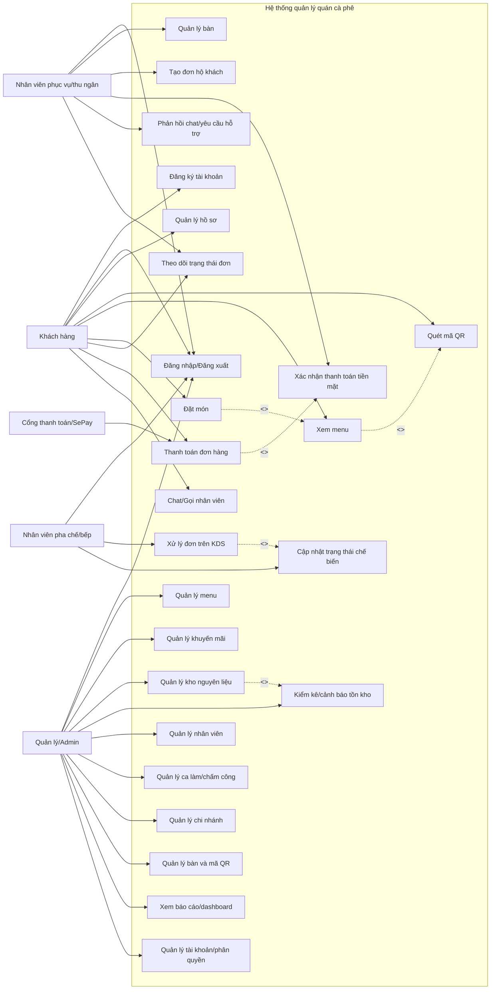

### 3.5.1. Danh sách các Actor

**Bảng 3.5. Danh sách Actor của hệ thống**

| Actor | Vai trò trong hệ thống |
| --- | --- |
| Khách hàng | Người sử dụng dịch vụ tại bàn, có thể quét QR, xem menu, đặt món, thanh toán, theo dõi trạng thái đơn và gửi yêu cầu hỗ trợ. |
| Nhân viên phục vụ/thu ngân | Người vận hành khu vực phục vụ, theo dõi bàn, tạo đơn hộ khách, xác nhận thanh toán tiền mặt và phản hồi yêu cầu hỗ trợ. |
| Nhân viên pha chế/bếp | Người tiếp nhận đơn trên màn hình KDS, cập nhật trạng thái chế biến và xác nhận hoàn thành món. |
| Quản lý/Admin | Người cấu hình và giám sát hệ thống, quản lý menu, kho, nhân viên, chi nhánh, bàn, khuyến mãi, tài khoản và báo cáo vận hành. |
| Cổng thanh toán/SePay | Hệ thống bên ngoài gửi kết quả giao dịch QR/chuyển khoản để Payment Service xác nhận trạng thái thanh toán. |

### 3.5.2. Danh sách các Use Case

**Bảng 3.6. Danh sách nhóm Use Case chính**

| Nhóm Use Case | Use Case chính |
| --- | --- |
| Tài khoản | Đăng ký, đăng nhập, đăng xuất, quản lý hồ sơ, đổi/quên mật khẩu, quản lý phiên đăng nhập và phân quyền theo vai trò. |
| Khách hàng đặt món | Quét QR bàn, xem menu, xem chi tiết món, chọn tùy chọn món, đặt món, theo dõi trạng thái đơn và gọi nhân viên hỗ trợ. |
| Thanh toán | Tạo giao dịch thanh toán, thanh toán tiền mặt, thanh toán QR/SePay, xử lý webhook thanh toán, xác nhận thanh toán và xem kết quả. |
| Vận hành bàn | Quản lý bàn, cập nhật trạng thái bàn, tạo đơn hộ khách, xử lý yêu cầu gọi nhân viên và phản hồi chat. |
| KDS/Bếp | Tiếp nhận đơn, xem danh sách món chờ xử lý, cập nhật trạng thái chế biến và xác nhận hoàn thành món. |
| Menu/khuyến mãi | Quản lý danh mục, món, tùy chọn món, trạng thái bán, giá bán và chương trình khuyến mãi. |
| Kho nguyên liệu | Quản lý nguyên liệu, nhập kho, xuất kho, điều chỉnh tồn, kiểm kê, cảnh báo tồn kho thấp và trừ kho theo món hoàn thành. |
| Nhân sự/chi nhánh | Quản lý nhân viên, vai trò, chi nhánh, ca làm, chấm công và quyền truy cập. |
| Báo cáo/phân tích | Xem dashboard doanh thu, đơn hàng, thanh toán, kho, nhân sự và các chỉ số vận hành theo thời gian. |

## 3.6. Đặc tả Use Case

### 3.6.1. Use Case Actor Khách hàng

#### UC-C01 - Đăng ký tài khoản khách hàng

| Thành phần | Nội dung |
| --- | --- |
| Tên use case | Đăng ký tài khoản khách hàng |
| Mô tả sơ lược | Cho phép khách hàng tạo tài khoản để lưu thông tin cá nhân, lịch sử đặt món và sử dụng các chức năng cá nhân hóa. |
| Actor chính | Khách hàng |
| Actor phụ | User Service, đơn vị gửi thông báo nếu có OTP/email |
| Tiền điều kiện | Khách hàng chưa có tài khoản và đang ở màn hình đăng ký. |
| Hậu điều kiện | Tài khoản khách hàng được tạo thành công và có thể đăng nhập. |

**Luồng sự kiện chính**

| Actor | System |
| --- | --- |
| 1. Khách hàng chọn chức năng đăng ký. | 2. Hệ thống hiển thị biểu mẫu đăng ký. |
| 3. Khách hàng nhập thông tin bắt buộc. | 4. Hệ thống kiểm tra tính hợp lệ và tính duy nhất của email/số điện thoại. |
| 5. Khách hàng xác nhận tạo tài khoản. | 6. Hệ thống tạo tài khoản và thông báo đăng ký thành công. |

**Luồng sự kiện thay thế**

| Trường hợp | Xử lý |
| --- | --- |
| Khách hàng đã có tài khoản | Hệ thống chuyển sang màn hình đăng nhập. |
| Có yêu cầu xác minh OTP/email | Hệ thống lưu trạng thái chờ xác minh và chỉ kích hoạt tài khoản sau khi xác minh thành công. |

**Luồng sự kiện ngoại lệ**

| Trường hợp | Xử lý |
| --- | --- |
| Thiếu thông tin bắt buộc | Hệ thống yêu cầu bổ sung dữ liệu. |
| Email hoặc số điện thoại đã tồn tại | Hệ thống từ chối đăng ký và yêu cầu dùng thông tin khác. |

#### UC-C02 - Đăng nhập tài khoản khách hàng

| Thành phần | Nội dung |
| --- | --- |
| Tên use case | Đăng nhập tài khoản khách hàng |
| Mô tả sơ lược | Cho phép khách hàng truy cập tài khoản để đặt món, theo dõi đơn và quản lý thông tin cá nhân. |
| Actor chính | Khách hàng |
| Actor phụ | User Service, API Gateway |
| Tiền điều kiện | Khách hàng đã có tài khoản hợp lệ và tài khoản không bị khóa. |
| Hậu điều kiện | Khách hàng đăng nhập thành công và nhận token truy cập. |

**Luồng sự kiện chính**

| Actor | System |
| --- | --- |
| 1. Khách hàng mở màn hình đăng nhập. | 2. Hệ thống hiển thị biểu mẫu đăng nhập. |
| 3. Khách hàng nhập thông tin đăng nhập. | 4. Hệ thống kiểm tra thông tin và trạng thái tài khoản. |
| 5. Khách hàng xác nhận đăng nhập. | 6. Hệ thống phát hành access token/refresh token và điều hướng vào giao diện phù hợp. |

**Luồng sự kiện thay thế**

| Trường hợp | Xử lý |
| --- | --- |
| Khách hàng quên mật khẩu | Hệ thống chuyển sang luồng khôi phục mật khẩu. |
| Khách hàng quay lại từ QR bàn | Hệ thống giữ thông tin `tableId` sau khi đăng nhập thành công. |

**Luồng sự kiện ngoại lệ**

| Trường hợp | Xử lý |
| --- | --- |
| Sai thông tin đăng nhập | Hệ thống thông báo lỗi và cho phép nhập lại. |
| Đăng nhập sai nhiều lần | Hệ thống tạm giới hạn đăng nhập theo chính sách bảo mật. |

#### UC-C03 - Quản lý hồ sơ khách hàng

| Thành phần | Nội dung |
| --- | --- |
| Tên use case | Quản lý hồ sơ khách hàng |
| Mô tả sơ lược | Cho phép khách hàng xem và cập nhật thông tin cá nhân phục vụ liên hệ, hóa đơn hoặc chăm sóc khách hàng. |
| Actor chính | Khách hàng |
| Actor phụ | User Service |
| Tiền điều kiện | Khách hàng đã đăng nhập. |
| Hậu điều kiện | Thông tin hồ sơ được cập nhật và lưu trữ thành công. |

**Luồng sự kiện chính**

| Actor | System |
| --- | --- |
| 1. Khách hàng mở trang hồ sơ. | 2. Hệ thống hiển thị thông tin hiện tại. |
| 3. Khách hàng chỉnh sửa thông tin cần cập nhật. | 4. Hệ thống kiểm tra tính hợp lệ của dữ liệu mới. |
| 5. Khách hàng xác nhận lưu thay đổi. | 6. Hệ thống cập nhật hồ sơ và thông báo thành công. |

**Luồng sự kiện ngoại lệ**

| Trường hợp | Xử lý |
| --- | --- |
| Dữ liệu sai định dạng | Hệ thống cảnh báo trường không hợp lệ và yêu cầu chỉnh sửa. |
| Phiên đăng nhập hết hạn | Hệ thống yêu cầu đăng nhập lại trước khi lưu. |

#### UC-C04 - Quét QR và xem menu

| Thành phần | Nội dung |
| --- | --- |
| Tên use case | Quét QR và xem menu |
| Mô tả sơ lược | Cho phép khách hàng quét mã QR tại bàn để xem danh sách món, danh mục, giá bán và tùy chọn món. |
| Actor chính | Khách hàng |
| Actor phụ | Table Service, Order Service, API Gateway |
| Tiền điều kiện | Mã QR hoặc `tableId` hợp lệ. |
| Hậu điều kiện | Khách hàng xem được menu khả dụng theo bàn/chi nhánh. |

**Luồng sự kiện chính**

| Actor | System |
| --- | --- |
| 1. Khách hàng quét QR tại bàn. | 2. Hệ thống mở giao diện khách hàng kèm `tableId`. |
| 3. Khách hàng yêu cầu xem menu. | 4. API Gateway kiểm tra `tableId` với Table Service. |
| 5. Khách hàng duyệt danh mục và món. | 6. Order Service trả danh sách menu, tùy chọn và trạng thái bán. |

**Luồng sự kiện ngoại lệ**

| Trường hợp | Xử lý |
| --- | --- |
| Mã QR không hợp lệ hoặc bàn ngừng phục vụ | Hệ thống từ chối truy cập và thông báo lỗi. |
| Món tạm hết hoặc tạm ngừng bán | Hệ thống hiển thị trạng thái không khả dụng và không cho đặt món đó. |

#### UC-C05 - Đặt món tại bàn

| Thành phần | Nội dung |
| --- | --- |
| Tên use case | Đặt món tại bàn |
| Mô tả sơ lược | Cho phép khách hàng chọn món, số lượng, tùy chọn và tạo đơn hàng tại bàn. |
| Actor chính | Khách hàng |
| Actor phụ | Order Service, Table Service, Chat Service/KDS, Kafka |
| Tiền điều kiện | Khách hàng đang ở bàn hợp lệ và đã chọn ít nhất một món. |
| Hậu điều kiện | Đơn hàng được tạo và gửi đến khu vực xử lý của nhân viên/bếp. |

**Luồng sự kiện chính**

| Actor | System |
| --- | --- |
| 1. Khách hàng chọn món, số lượng và tùy chọn. | 2. Hệ thống tính tạm tính đơn hàng. |
| 3. Khách hàng xác nhận đặt món. | 4. Order Service kiểm tra dữ liệu, giá bán và trạng thái món. |
| 5. Khách hàng chờ kết quả tạo đơn. | 6. Hệ thống tạo đơn, cấp mã đơn và thông báo đơn mới cho nhân viên/KDS. |

**Luồng sự kiện thay thế**

| Trường hợp | Xử lý |
| --- | --- |
| Khách hàng cập nhật món trước khi gửi | Hệ thống tính lại tổng tiền và danh sách món. |
| Khách hàng gửi ghi chú cho món | Hệ thống lưu ghi chú cùng chi tiết món trong đơn. |

**Luồng sự kiện ngoại lệ**

| Trường hợp | Xử lý |
| --- | --- |
| Gửi lặp yêu cầu tạo đơn | Hệ thống dùng cơ chế chống trùng nếu có `Idempotency-Key`. |
| Món không còn khả dụng tại thời điểm xác nhận | Hệ thống từ chối tạo đơn và yêu cầu cập nhật lại giỏ món. |

#### UC-C06 - Theo dõi trạng thái đơn

| Thành phần | Nội dung |
| --- | --- |
| Tên use case | Theo dõi trạng thái đơn |
| Mô tả sơ lược | Cho phép khách hàng xem trạng thái đơn và từng món sau khi đặt. |
| Actor chính | Khách hàng |
| Actor phụ | Order Service, Chat Service/Socket.IO |
| Tiền điều kiện | Khách hàng có mã đơn hoặc phiên bàn hợp lệ. |
| Hậu điều kiện | Khách hàng nắm được trạng thái mới nhất của đơn hàng. |

**Luồng sự kiện chính**

| Actor | System |
| --- | --- |
| 1. Khách hàng mở màn hình theo dõi đơn. | 2. Hệ thống hiển thị danh sách món và trạng thái hiện tại. |
| 3. Khách hàng làm mới hoặc chờ cập nhật realtime. | 4. Hệ thống cập nhật trạng thái khi nhân viên/bếp thay đổi. |
| 5. Khách hàng xem trạng thái hoàn thành. | 6. Hệ thống hiển thị thông tin món đã sẵn sàng/phục vụ. |

**Luồng sự kiện ngoại lệ**

| Trường hợp | Xử lý |
| --- | --- |
| Không tìm thấy đơn | Hệ thống thông báo đơn không tồn tại hoặc không thuộc phiên hiện tại. |
| Kết nối realtime gián đoạn | Hệ thống cho phép tải lại trạng thái bằng API. |

#### UC-C07 - Thanh toán đơn hàng

| Thành phần | Nội dung |
| --- | --- |
| Tên use case | Thanh toán đơn hàng |
| Mô tả sơ lược | Cho phép khách hàng thanh toán đơn bằng tiền mặt hoặc QR/SePay. |
| Actor chính | Khách hàng |
| Actor phụ | Payment Service, Order Service, cổng thanh toán/SePay, nhân viên thu ngân |
| Tiền điều kiện | Đơn hàng hợp lệ và có số tiền cần thanh toán. |
| Hậu điều kiện | Kết quả thanh toán được ghi nhận và trạng thái đơn được cập nhật. |

**Luồng sự kiện chính**

| Actor | System |
| --- | --- |
| 1. Khách hàng mở màn hình thanh toán. | 2. Hệ thống hiển thị số tiền và phương thức thanh toán. |
| 3. Khách hàng chọn phương thức thanh toán. | 4. Payment Service tạo giao dịch thanh toán. |
| 5. Khách hàng hoàn tất theo hướng dẫn. | 6. Hệ thống ghi nhận kết quả và cập nhật trạng thái thanh toán. |

**Luồng sự kiện thay thế**

| Trường hợp | Xử lý |
| --- | --- |
| Thanh toán tiền mặt | Hệ thống tạo giao dịch chờ nhân viên xác nhận. |
| Thanh toán QR/SePay | Hệ thống hiển thị QR và chờ webhook/kết quả từ cổng thanh toán. |

**Luồng sự kiện ngoại lệ**

| Trường hợp | Xử lý |
| --- | --- |
| Thanh toán online chưa được xác nhận | Hệ thống giữ trạng thái chờ xử lý. |
| Webhook không hợp lệ | Hệ thống từ chối cập nhật trạng thái thanh toán. |

#### UC-C08 - Chat/Gọi nhân viên

| Thành phần | Nội dung |
| --- | --- |
| Tên use case | Chat/Gọi nhân viên |
| Mô tả sơ lược | Cho phép khách hàng gửi yêu cầu hỗ trợ hoặc trao đổi với nhân viên theo thời gian thực. |
| Actor chính | Khách hàng |
| Actor phụ | Chat Service, Redis, Socket.IO, nhân viên phục vụ |
| Tiền điều kiện | Khách hàng đang ở giao diện chat hoặc có `tableId` hợp lệ. |
| Hậu điều kiện | Tin nhắn/yêu cầu hỗ trợ được lưu và gửi đến nhân viên. |

**Luồng sự kiện chính**

| Actor | System |
| --- | --- |
| 1. Khách hàng mở khung chat hoặc chọn gọi nhân viên. | 2. Hệ thống tải lịch sử hội thoại/yêu cầu theo bàn. |
| 3. Khách hàng nhập nội dung hoặc chọn loại yêu cầu. | 4. Chat Service lưu yêu cầu và phát realtime đến nhân viên. |
| 5. Khách hàng chờ phản hồi. | 6. Hệ thống cập nhật hội thoại theo thời gian thực. |

**Luồng sự kiện ngoại lệ**

| Trường hợp | Xử lý |
| --- | --- |
| Nội dung không hợp lệ | Hệ thống từ chối gửi và yêu cầu chỉnh sửa. |
| Không xác định được bàn | Hệ thống yêu cầu quét lại QR hoặc liên hệ trực tiếp nhân viên. |

### 3.6.2. Use Case Actor Nhân viên phục vụ/thu ngân và nhân viên pha chế

#### UC-S01 - Đăng nhập nhân viên

| Thành phần | Nội dung |
| --- | --- |
| Tên use case | Đăng nhập nhân viên |
| Mô tả sơ lược | Cho phép nhân viên đăng nhập vào khu vực vận hành theo vai trò được cấp. |
| Actor chính | Nhân viên phục vụ/thu ngân, nhân viên pha chế/bếp |
| Actor phụ | User Service, API Gateway |
| Tiền điều kiện | Nhân viên đã có tài khoản hợp lệ. |
| Hậu điều kiện | Nhân viên đăng nhập thành công và được điều hướng đến giao diện phù hợp. |

**Luồng sự kiện chính**

| Actor | System |
| --- | --- |
| 1. Nhân viên mở màn hình đăng nhập. | 2. Hệ thống hiển thị biểu mẫu đăng nhập. |
| 3. Nhân viên nhập thông tin đăng nhập. | 4. Hệ thống xác thực tài khoản và vai trò. |
| 5. Nhân viên xác nhận đăng nhập. | 6. Hệ thống phát hành token và mở khu vực vận hành tương ứng. |

**Luồng sự kiện ngoại lệ**

| Trường hợp | Xử lý |
| --- | --- |
| Nhân viên không có quyền truy cập chức năng | Hệ thống từ chối và hiển thị thông báo không đủ quyền. |
| Tài khoản bị khóa | Hệ thống từ chối đăng nhập và yêu cầu liên hệ quản lý. |

#### UC-S02 - Quản lý bàn

| Thành phần | Nội dung |
| --- | --- |
| Tên use case | Quản lý bàn |
| Mô tả sơ lược | Cho phép nhân viên xem danh sách bàn, cập nhật trạng thái bàn và xử lý yêu cầu gọi nhân viên. |
| Actor chính | Nhân viên phục vụ/thu ngân |
| Actor phụ | Table Service, Chat Service |
| Tiền điều kiện | Nhân viên đã đăng nhập và có quyền vận hành bàn. |
| Hậu điều kiện | Trạng thái bàn hoặc yêu cầu hỗ trợ được cập nhật. |

**Luồng sự kiện chính**

| Actor | System |
| --- | --- |
| 1. Nhân viên mở màn hình bàn. | 2. Hệ thống hiển thị danh sách bàn và trạng thái hiện tại. |
| 3. Nhân viên chọn bàn cần xử lý. | 4. Hệ thống hiển thị chi tiết bàn, QR và yêu cầu liên quan. |
| 5. Nhân viên cập nhật trạng thái bàn. | 6. Table Service lưu thay đổi và cập nhật giao diện. |

**Luồng sự kiện ngoại lệ**

| Trường hợp | Xử lý |
| --- | --- |
| Cập nhật trạng thái không hợp lệ | Hệ thống từ chối và yêu cầu chọn trạng thái phù hợp. |
| Bàn thuộc chi nhánh khác | Hệ thống không cho phép thao tác nếu nhân viên không có quyền. |

#### UC-S03 - Tạo đơn hộ khách

| Thành phần | Nội dung |
| --- | --- |
| Tên use case | Tạo đơn hộ khách |
| Mô tả sơ lược | Cho phép nhân viên tạo đơn thay khách trong trường hợp khách gọi trực tiếp hoặc không sử dụng QR. |
| Actor chính | Nhân viên phục vụ/thu ngân |
| Actor phụ | Order Service, Table Service |
| Tiền điều kiện | Nhân viên đã đăng nhập và bàn đang ở trạng thái cho phép phục vụ. |
| Hậu điều kiện | Đơn hàng được tạo và chuyển đến khu vực pha chế/bếp. |

**Luồng sự kiện chính**

| Actor | System |
| --- | --- |
| 1. Nhân viên chọn bàn cần tạo đơn. | 2. Hệ thống hiển thị menu và thông tin bàn. |
| 3. Nhân viên nhập món theo yêu cầu của khách. | 4. Hệ thống tính tạm tính và kiểm tra trạng thái món. |
| 5. Nhân viên xác nhận tạo đơn. | 6. Order Service tạo đơn và thông báo đến KDS. |

**Luồng sự kiện ngoại lệ**

| Trường hợp | Xử lý |
| --- | --- |
| Bàn không hợp lệ hoặc đang đóng | Hệ thống từ chối tạo đơn. |
| Món đã ngừng bán | Hệ thống yêu cầu chọn món khác. |

#### UC-S04 - Xử lý đơn trên KDS

| Thành phần | Nội dung |
| --- | --- |
| Tên use case | Xử lý đơn trên KDS |
| Mô tả sơ lược | Cho phép nhân viên pha chế/bếp tiếp nhận đơn và cập nhật trạng thái từng món. |
| Actor chính | Nhân viên pha chế/bếp |
| Actor phụ | Order Service, Inventory Service, Kafka |
| Tiền điều kiện | Có đơn hàng mới hoặc món đang chờ xử lý. |
| Hậu điều kiện | Trạng thái món được cập nhật và có thể phát sinh sự kiện trừ kho. |

**Luồng sự kiện chính**

| Actor | System |
| --- | --- |
| 1. Nhân viên mở màn hình KDS. | 2. Hệ thống hiển thị các đơn/món cần xử lý. |
| 3. Nhân viên chọn món và cập nhật trạng thái đang chuẩn bị. | 4. Order Service kiểm tra quyền và trạng thái hợp lệ. |
| 5. Nhân viên xác nhận hoàn thành món. | 6. Hệ thống cập nhật trạng thái, thông báo cho khách/nhân viên và phát sự kiện nếu cần. |

**Luồng sự kiện ngoại lệ**

| Trường hợp | Xử lý |
| --- | --- |
| Nhân viên không có quyền cập nhật KDS | Hệ thống từ chối thao tác. |
| Trạng thái chuyển đổi không hợp lệ | Hệ thống yêu cầu chọn lại trạng thái phù hợp. |

#### UC-S05 - Xác nhận thanh toán tiền mặt

| Thành phần | Nội dung |
| --- | --- |
| Tên use case | Xác nhận thanh toán tiền mặt |
| Mô tả sơ lược | Cho phép nhân viên xác nhận khách đã thanh toán bằng tiền mặt tại quầy hoặc tại bàn. |
| Actor chính | Nhân viên phục vụ/thu ngân |
| Actor phụ | Payment Service, Order Service |
| Tiền điều kiện | Có giao dịch tiền mặt đang chờ xác nhận. |
| Hậu điều kiện | Giao dịch được cập nhật trạng thái thanh toán thành công. |

**Luồng sự kiện chính**

| Actor | System |
| --- | --- |
| 1. Nhân viên mở danh sách thanh toán. | 2. Hệ thống hiển thị giao dịch đang chờ. |
| 3. Nhân viên kiểm tra số tiền và đơn hàng. | 4. Hệ thống hiển thị thông tin đối chiếu. |
| 5. Nhân viên xác nhận đã nhận tiền. | 6. Payment Service cập nhật trạng thái giao dịch và thông báo kết quả. |

**Luồng sự kiện ngoại lệ**

| Trường hợp | Xử lý |
| --- | --- |
| Số tiền hoặc đơn hàng không khớp | Nhân viên từ chối xác nhận và kiểm tra lại với khách. |
| Giao dịch đã được xử lý | Hệ thống không cho xác nhận lại để tránh ghi nhận trùng. |

#### UC-S06 - Phản hồi chat/yêu cầu hỗ trợ

| Thành phần | Nội dung |
| --- | --- |
| Tên use case | Phản hồi chat/yêu cầu hỗ trợ |
| Mô tả sơ lược | Cho phép nhân viên tiếp nhận và phản hồi yêu cầu hỗ trợ từ khách hàng theo bàn. |
| Actor chính | Nhân viên phục vụ/thu ngân |
| Actor phụ | Chat Service, Redis, Socket.IO |
| Tiền điều kiện | Có tin nhắn hoặc yêu cầu hỗ trợ từ khách hàng. |
| Hậu điều kiện | Yêu cầu được phản hồi hoặc cập nhật trạng thái xử lý. |

**Luồng sự kiện chính**

| Actor | System |
| --- | --- |
| 1. Nhân viên mở danh sách yêu cầu hỗ trợ. | 2. Hệ thống hiển thị tin nhắn/yêu cầu theo bàn. |
| 3. Nhân viên chọn một hội thoại. | 4. Hệ thống hiển thị lịch sử trao đổi. |
| 5. Nhân viên gửi phản hồi hoặc đánh dấu đã xử lý. | 6. Chat Service lưu và phát realtime đến khách hàng. |

**Luồng sự kiện ngoại lệ**

| Trường hợp | Xử lý |
| --- | --- |
| Hội thoại đã đóng | Hệ thống chỉ cho xem lịch sử, không cho gửi thêm phản hồi. |
| Nhân viên không thuộc chi nhánh/bàn | Hệ thống từ chối thao tác. |

#### UC-S07 - Theo dõi danh sách đơn vận hành

| Thành phần | Nội dung |
| --- | --- |
| Tên use case | Theo dõi danh sách đơn vận hành |
| Mô tả sơ lược | Cho phép nhân viên xem danh sách đơn theo trạng thái để phục vụ, đối soát hoặc hỗ trợ khách. |
| Actor chính | Nhân viên phục vụ/thu ngân |
| Actor phụ | Order Service |
| Tiền điều kiện | Nhân viên đã đăng nhập và có quyền xem đơn. |
| Hậu điều kiện | Nhân viên nắm được trạng thái xử lý hiện tại của đơn hàng. |

**Luồng sự kiện chính**

| Actor | System |
| --- | --- |
| 1. Nhân viên mở danh sách đơn. | 2. Hệ thống hiển thị đơn theo trạng thái gần nhất. |
| 3. Nhân viên lọc theo bàn, trạng thái hoặc thời gian. | 4. Hệ thống cập nhật danh sách theo điều kiện lọc. |
| 5. Nhân viên mở chi tiết đơn. | 6. Hệ thống hiển thị món, thanh toán và lịch sử trạng thái. |

**Luồng sự kiện ngoại lệ**

| Trường hợp | Xử lý |
| --- | --- |
| Không có đơn phù hợp | Hệ thống hiển thị trạng thái rỗng. |
| Đơn không thuộc phạm vi chi nhánh | Hệ thống từ chối truy cập chi tiết. |

### 3.6.3. Use Case Actor Quản lý/Admin

#### UC-A01 - Đăng nhập Quản lý/Admin

| Thành phần | Nội dung |
| --- | --- |
| Tên use case | Đăng nhập Quản lý/Admin |
| Mô tả sơ lược | Cho phép quản lý hoặc quản trị viên đăng nhập vào khu vực quản trị hệ thống. |
| Actor chính | Quản lý/Admin |
| Actor phụ | User Service, API Gateway |
| Tiền điều kiện | Tài khoản đã được cấp quyền quản lý hoặc quản trị. |
| Hậu điều kiện | Người dùng truy cập được khu vực quản trị theo vai trò. |

**Luồng sự kiện chính**

| Actor | System |
| --- | --- |
| 1. Quản lý mở màn hình đăng nhập. | 2. Hệ thống hiển thị biểu mẫu đăng nhập. |
| 3. Quản lý nhập thông tin đăng nhập. | 4. Hệ thống xác thực tài khoản và quyền truy cập. |
| 5. Quản lý xác nhận đăng nhập. | 6. Hệ thống phát hành token và điều hướng đến dashboard quản trị. |

**Luồng sự kiện ngoại lệ**

| Trường hợp | Xử lý |
| --- | --- |
| Tài khoản không có quyền quản trị | Hệ thống từ chối truy cập khu vực quản lý. |
| Tài khoản bị khóa | Hệ thống hiển thị lý do và yêu cầu liên hệ quản trị viên. |

#### UC-A02 - Quản lý menu

| Thành phần | Nội dung |
| --- | --- |
| Tên use case | Quản lý menu |
| Mô tả sơ lược | Cho phép quản lý tạo, cập nhật, xóa danh mục, món, tùy chọn món, giá bán và trạng thái bán. |
| Actor chính | Quản lý/Admin |
| Actor phụ | Order Service |
| Tiền điều kiện | Quản lý đã đăng nhập và có quyền quản trị menu. |
| Hậu điều kiện | Thông tin menu được cập nhật và hiển thị cho khách hàng/nhân viên. |

**Luồng sự kiện chính**

| Actor | System |
| --- | --- |
| 1. Quản lý mở màn hình menu. | 2. Hệ thống hiển thị danh mục và món hiện có. |
| 3. Quản lý tạo hoặc chỉnh sửa món. | 4. Hệ thống kiểm tra dữ liệu nhập, giá bán và trạng thái. |
| 5. Quản lý xác nhận lưu. | 6. Order Service cập nhật menu và trả kết quả. |

**Luồng sự kiện ngoại lệ**

| Trường hợp | Xử lý |
| --- | --- |
| Thiếu thông tin bắt buộc | Hệ thống từ chối lưu và yêu cầu bổ sung. |
| Xóa món đang có trong đơn hoạt động | Hệ thống chỉ cho tạm ngừng bán hoặc lưu trạng thái không hiển thị. |

#### UC-A03 - Quản lý khuyến mãi

| Thành phần | Nội dung |
| --- | --- |
| Tên use case | Quản lý khuyến mãi |
| Mô tả sơ lược | Cho phép quản lý tạo và cập nhật chương trình giảm giá theo món, danh mục hoặc thời gian áp dụng. |
| Actor chính | Quản lý/Admin |
| Actor phụ | Order Service |
| Tiền điều kiện | Quản lý đã đăng nhập và có quyền cấu hình khuyến mãi. |
| Hậu điều kiện | Chương trình khuyến mãi được lưu và áp dụng theo điều kiện cấu hình. |

**Luồng sự kiện chính**

| Actor | System |
| --- | --- |
| 1. Quản lý mở khu vực khuyến mãi. | 2. Hệ thống hiển thị danh sách chương trình hiện có. |
| 3. Quản lý tạo hoặc chỉnh sửa chương trình. | 4. Hệ thống kiểm tra thời gian, phạm vi áp dụng và giá trị giảm. |
| 5. Quản lý xác nhận lưu. | 6. Hệ thống cập nhật khuyến mãi và áp dụng cho đơn phù hợp. |

**Luồng sự kiện ngoại lệ**

| Trường hợp | Xử lý |
| --- | --- |
| Thời gian áp dụng không hợp lệ | Hệ thống yêu cầu chọn lại thời gian. |
| Khuyến mãi xung đột chính sách | Hệ thống từ chối hoặc yêu cầu điều chỉnh điều kiện. |

#### UC-A04 - Quản lý kho nguyên liệu

| Thành phần | Nội dung |
| --- | --- |
| Tên use case | Quản lý kho nguyên liệu |
| Mô tả sơ lược | Cho phép quản lý theo dõi nguyên liệu, nhập/xuất kho, điều chỉnh tồn, kiểm kê và cảnh báo tồn thấp. |
| Actor chính | Quản lý/Admin |
| Actor phụ | Inventory Service, Kafka |
| Tiền điều kiện | Quản lý đã đăng nhập và có quyền quản lý kho. |
| Hậu điều kiện | Tồn kho và lịch sử biến động kho được cập nhật. |

**Luồng sự kiện chính**

| Actor | System |
| --- | --- |
| 1. Quản lý mở màn hình kho. | 2. Hệ thống hiển thị danh sách nguyên liệu và tồn hiện tại. |
| 3. Quản lý chọn nhập, xuất, điều chỉnh hoặc kiểm kê. | 4. Hệ thống hiển thị biểu mẫu tương ứng. |
| 5. Quản lý xác nhận lưu. | 6. Inventory Service ghi nhận stock movement, cập nhật tồn kho và cảnh báo nếu thấp hơn ngưỡng. |

**Luồng sự kiện ngoại lệ**

| Trường hợp | Xử lý |
| --- | --- |
| Số lượng nhập/xuất không hợp lệ | Hệ thống từ chối lưu và yêu cầu nhập lại. |
| Xuất kho vượt tồn hiện có | Hệ thống từ chối thao tác hoặc yêu cầu quyền điều chỉnh đặc biệt. |

#### UC-A05 - Quản lý nhân viên và phân quyền

| Thành phần | Nội dung |
| --- | --- |
| Tên use case | Quản lý nhân viên và phân quyền |
| Mô tả sơ lược | Cho phép quản lý tạo, cập nhật, khóa tài khoản nhân viên và gán vai trò phù hợp. |
| Actor chính | Quản lý/Admin |
| Actor phụ | User Service |
| Tiền điều kiện | Quản lý đã đăng nhập và có quyền quản trị nhân sự. |
| Hậu điều kiện | Dữ liệu nhân viên và quyền truy cập được cập nhật. |

**Luồng sự kiện chính**

| Actor | System |
| --- | --- |
| 1. Quản lý mở khu vực nhân viên. | 2. Hệ thống hiển thị danh sách nhân viên hiện có. |
| 3. Quản lý tạo mới hoặc chỉnh sửa nhân viên. | 4. Hệ thống kiểm tra dữ liệu và quyền thao tác. |
| 5. Quản lý xác nhận lưu. | 6. User Service cập nhật tài khoản, vai trò và trạng thái nhân viên. |

**Luồng sự kiện ngoại lệ**

| Trường hợp | Xử lý |
| --- | --- |
| Vai trò không hợp lệ | Hệ thống từ chối cập nhật và yêu cầu chọn vai trò phù hợp. |
| Tài khoản đang có phiên hoạt động | Hệ thống cập nhật quyền và có thể yêu cầu đăng nhập lại. |

#### UC-A06 - Quản lý chi nhánh, ca làm và chấm công

| Thành phần | Nội dung |
| --- | --- |
| Tên use case | Quản lý chi nhánh, ca làm và chấm công |
| Mô tả sơ lược | Cho phép quản lý cấu hình chi nhánh, phân ca, ghi nhận chấm công và theo dõi lịch làm việc. |
| Actor chính | Quản lý/Admin |
| Actor phụ | User Service |
| Tiền điều kiện | Quản lý đã đăng nhập và có quyền quản trị nhân sự/chi nhánh. |
| Hậu điều kiện | Dữ liệu chi nhánh, ca làm hoặc chấm công được cập nhật. |

**Luồng sự kiện chính**

| Actor | System |
| --- | --- |
| 1. Quản lý mở khu vực chi nhánh/ca làm. | 2. Hệ thống hiển thị danh sách chi nhánh, nhân viên và lịch ca. |
| 3. Quản lý tạo hoặc cập nhật ca làm. | 4. Hệ thống kiểm tra trùng lịch và quyền thao tác. |
| 5. Quản lý xác nhận lưu. | 6. Hệ thống cập nhật lịch làm việc hoặc dữ liệu chấm công. |

**Luồng sự kiện ngoại lệ**

| Trường hợp | Xử lý |
| --- | --- |
| Ca làm bị trùng | Hệ thống cảnh báo và yêu cầu điều chỉnh. |
| Nhân viên không thuộc chi nhánh | Hệ thống từ chối gán ca. |

#### UC-A07 - Quản lý bàn và mã QR

| Thành phần | Nội dung |
| --- | --- |
| Tên use case | Quản lý bàn và mã QR |
| Mô tả sơ lược | Cho phép quản lý tạo, cập nhật bàn, trạng thái bàn và mã QR dùng cho đặt món tại bàn. |
| Actor chính | Quản lý/Admin |
| Actor phụ | Table Service |
| Tiền điều kiện | Quản lý đã đăng nhập và có quyền quản lý bàn. |
| Hậu điều kiện | Thông tin bàn và mã QR được cập nhật. |

**Luồng sự kiện chính**

| Actor | System |
| --- | --- |
| 1. Quản lý mở khu vực bàn. | 2. Hệ thống hiển thị danh sách bàn và mã QR hiện có. |
| 3. Quản lý tạo mới, chỉnh sửa hoặc tạo lại QR. | 4. Hệ thống kiểm tra dữ liệu bàn và sinh mã QR nếu cần. |
| 5. Quản lý xác nhận lưu. | 6. Table Service cập nhật thông tin bàn và trạng thái QR. |

**Luồng sự kiện ngoại lệ**

| Trường hợp | Xử lý |
| --- | --- |
| Tên/số bàn trùng trong cùng chi nhánh | Hệ thống từ chối lưu và yêu cầu đổi thông tin. |
| QR đã bị vô hiệu hóa | Hệ thống yêu cầu tạo lại QR mới trước khi sử dụng. |

#### UC-A08 - Xem báo cáo/dashboard vận hành

| Thành phần | Nội dung |
| --- | --- |
| Tên use case | Xem báo cáo/dashboard vận hành |
| Mô tả sơ lược | Cho phép quản lý xem dashboard doanh thu, đơn hàng, thanh toán, kho và nhân sự. |
| Actor chính | Quản lý/Admin |
| Actor phụ | Report Service |
| Tiền điều kiện | Quản lý đã đăng nhập và có quyền xem báo cáo. |
| Hậu điều kiện | Báo cáo được hiển thị theo phạm vi thời gian hoặc điều kiện đã chọn. |

**Luồng sự kiện chính**

| Actor | System |
| --- | --- |
| 1. Quản lý mở dashboard. | 2. Hệ thống hiển thị bộ chỉ số mặc định. |
| 3. Quản lý chọn khoảng thời gian hoặc tiêu chí lọc. | 4. Report Service tổng hợp dữ liệu từ các nguồn liên quan. |
| 5. Quản lý xem chi tiết chỉ số. | 6. Hệ thống hiển thị biểu đồ và báo cáo mới nhất. |

**Luồng sự kiện ngoại lệ**

| Trường hợp | Xử lý |
| --- | --- |
| Không có dữ liệu trong khoảng thời gian chọn | Hệ thống hiển thị trạng thái chưa có dữ liệu. |
| Người dùng không đủ quyền xem dữ liệu chi nhánh | Hệ thống giới hạn phạm vi dữ liệu hoặc từ chối truy cập. |

#### UC-A09 - Quản lý tài khoản hệ thống

| Thành phần | Nội dung |
| --- | --- |
| Tên use case | Quản lý tài khoản hệ thống |
| Mô tả sơ lược | Cho phép Admin quản lý tài khoản, trạng thái truy cập, vai trò và phiên đăng nhập của người dùng nội bộ. |
| Actor chính | Quản lý/Admin |
| Actor phụ | User Service |
| Tiền điều kiện | Admin đã đăng nhập và có quyền quản trị hệ thống. |
| Hậu điều kiện | Tài khoản, vai trò hoặc phiên truy cập được cập nhật theo thao tác quản trị. |

**Luồng sự kiện chính**

| Actor | System |
| --- | --- |
| 1. Admin mở khu vực tài khoản. | 2. Hệ thống hiển thị danh sách tài khoản và vai trò. |
| 3. Admin chọn tài khoản cần xử lý. | 4. Hệ thống hiển thị thông tin, quyền và trạng thái hiện tại. |
| 5. Admin cập nhật vai trò, khóa/mở khóa hoặc thu hồi phiên. | 6. User Service ghi nhận thay đổi và lưu lịch sử thao tác. |

**Luồng sự kiện ngoại lệ**

| Trường hợp | Xử lý |
| --- | --- |
| Admin tự thu hồi quyền quản trị cuối cùng | Hệ thống từ chối thao tác để tránh mất quyền quản trị. |
| Vai trò không tồn tại | Hệ thống yêu cầu chọn lại vai trò hợp lệ. |

## 3.7. Sơ đồ Activity

### 3.7.1. Sơ đồ Activity của Actor Khách hàng

#### 3.7.1.1. Activity đăng ký tài khoản khách hàng

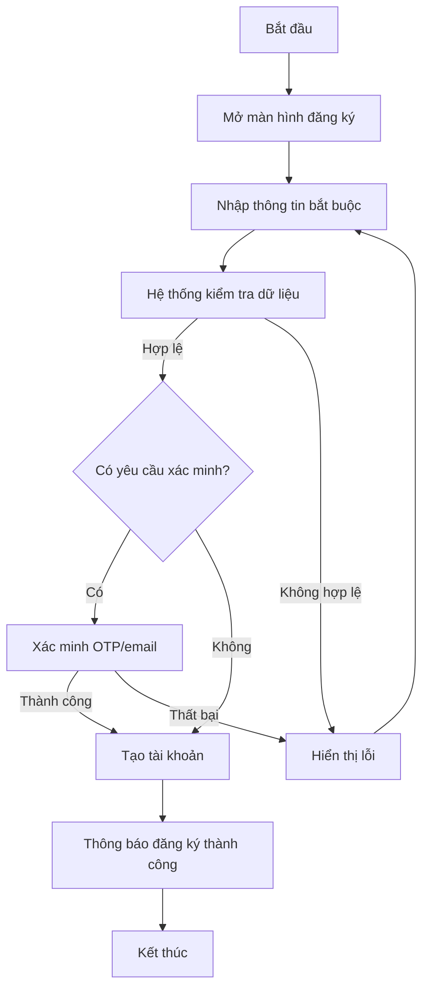

#### 3.7.1.2. Activity quét QR và đặt món

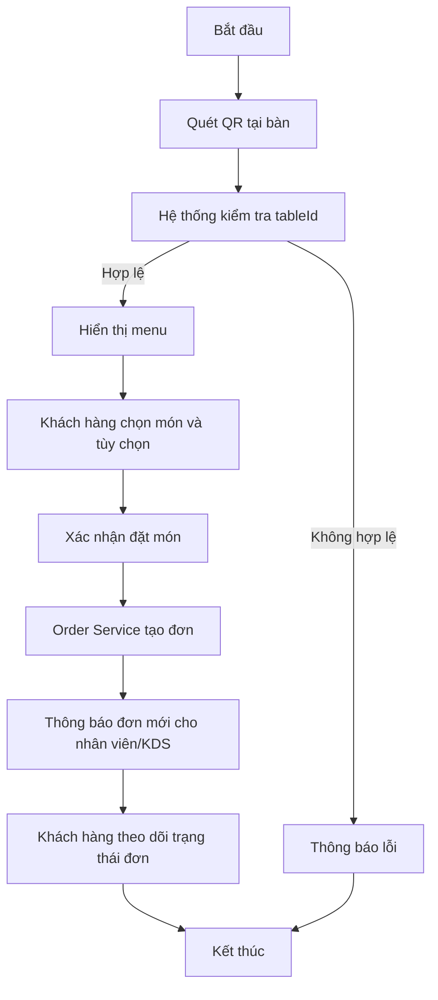

#### 3.7.1.3. Activity thanh toán

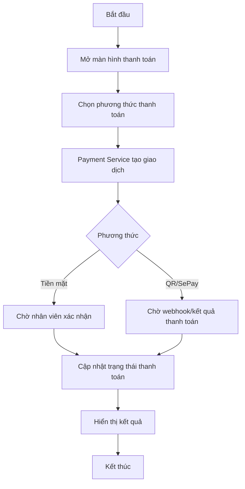

#### 3.7.1.4. Activity chat/gọi nhân viên

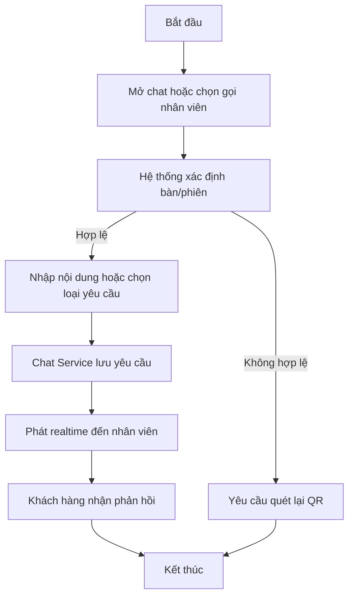

### 3.7.2. Sơ đồ Activity của Actor Nhân viên

#### 3.7.2.1. Activity quản lý bàn và yêu cầu hỗ trợ

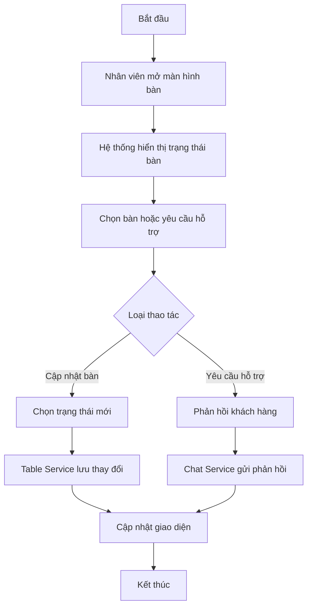

#### 3.7.2.2. Activity xử lý đơn trên KDS

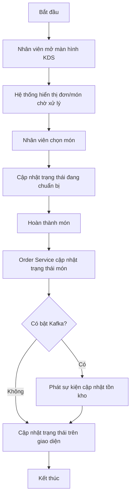

#### 3.7.2.3. Activity xác nhận thanh toán tiền mặt

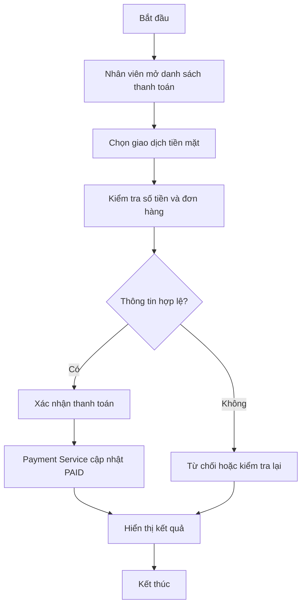

### 3.7.3. Sơ đồ Activity của Actor Quản lý/Admin

#### 3.7.3.1. Activity quản lý menu

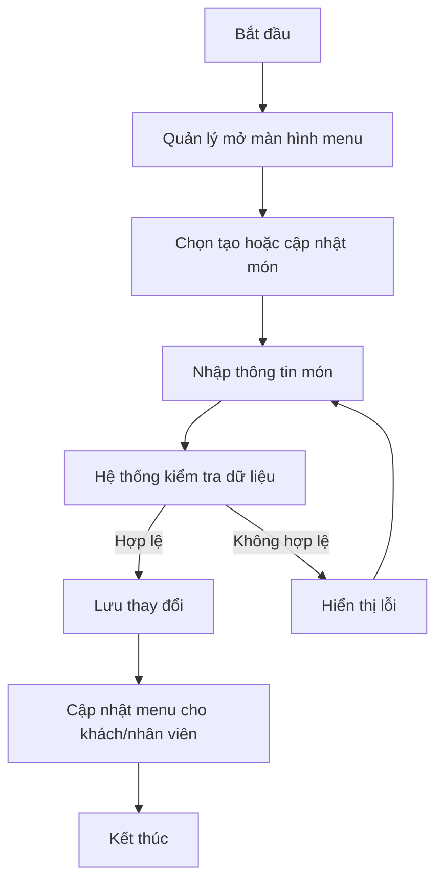

#### 3.7.3.2. Activity quản lý kho và cảnh báo tồn thấp

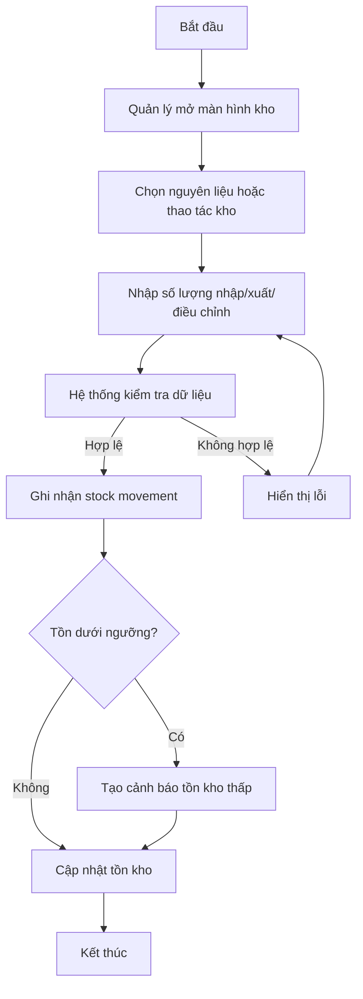

#### 3.7.3.3. Activity xem báo cáo vận hành

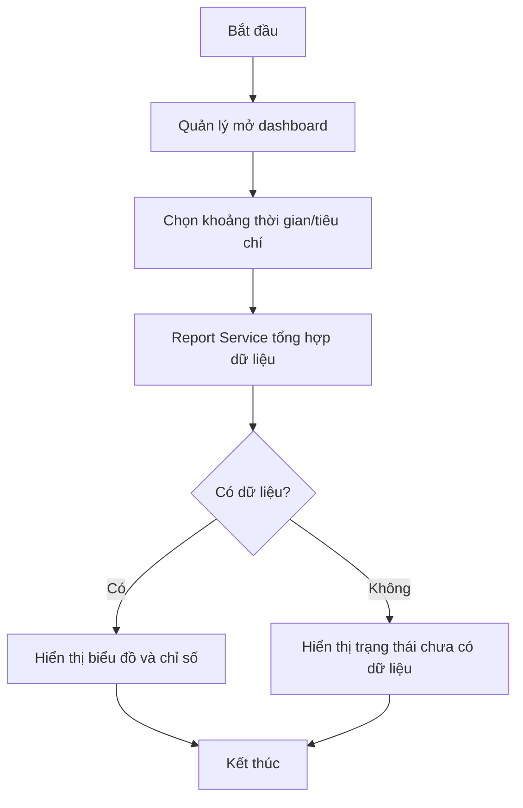

# CHƯƠNG 4. THIẾT KẾ HỆ THỐNG

## 4.1. Sơ đồ tuần tự (Sequence diagram)

### 4.1.1. Nhóm chức năng Khách hàng

#### 4.1.1.1. Sequence quét QR, xem menu và đặt món

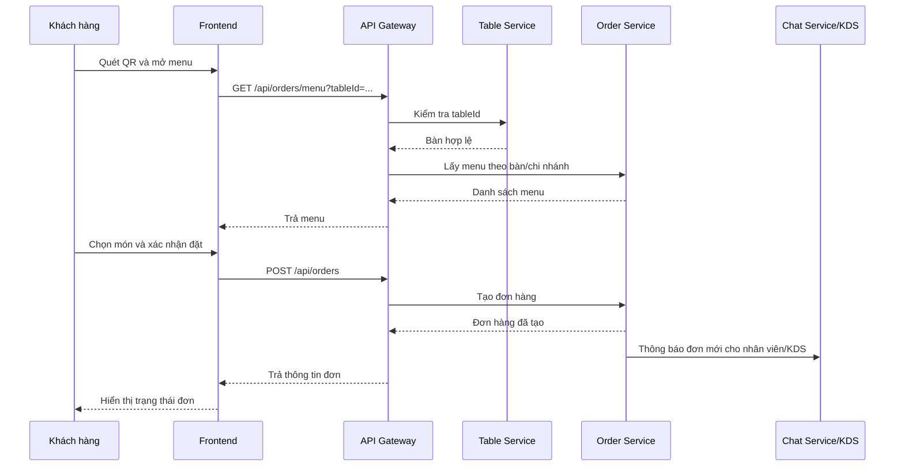

#### 4.1.1.2. Sequence theo dõi trạng thái đơn

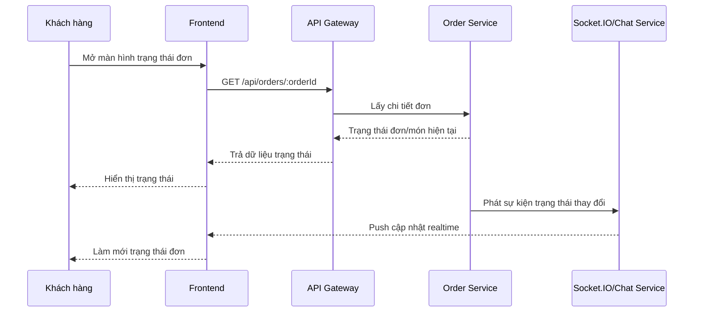

#### 4.1.1.3. Sequence thanh toán

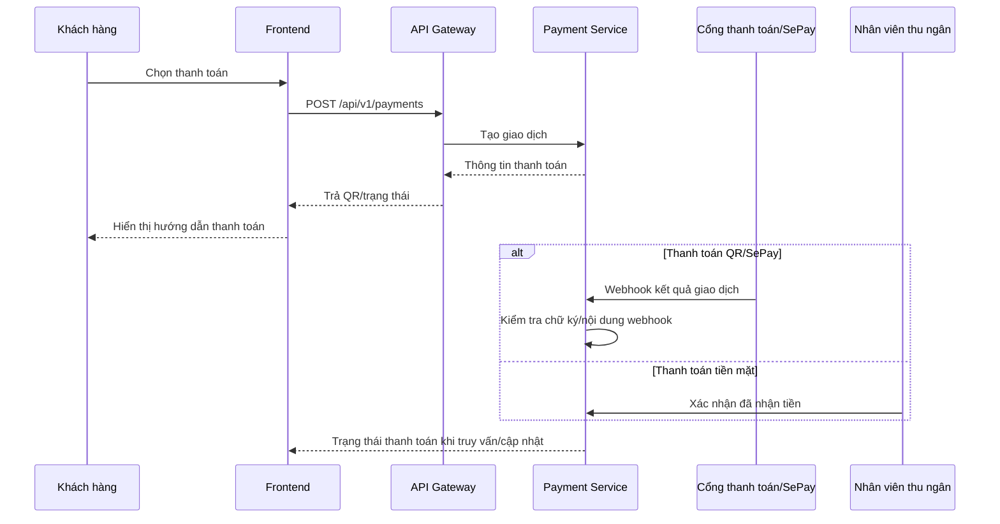

#### 4.1.1.4. Sequence chat/gọi nhân viên

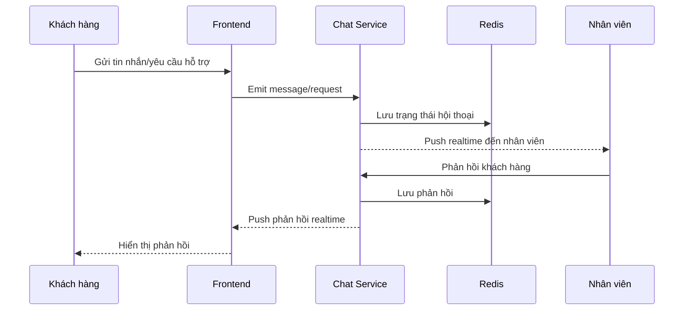

### 4.1.2. Nhóm chức năng Nhân viên

#### 4.1.2.1. Sequence quản lý bàn

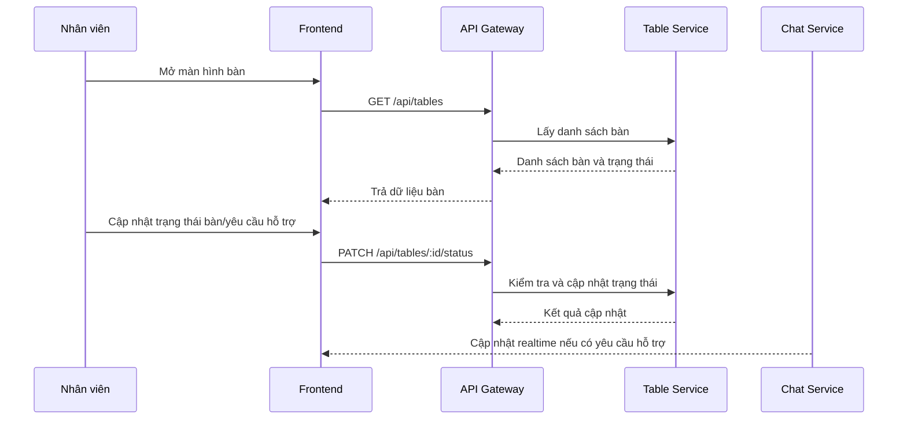

#### 4.1.2.2. Sequence xử lý đơn trên KDS

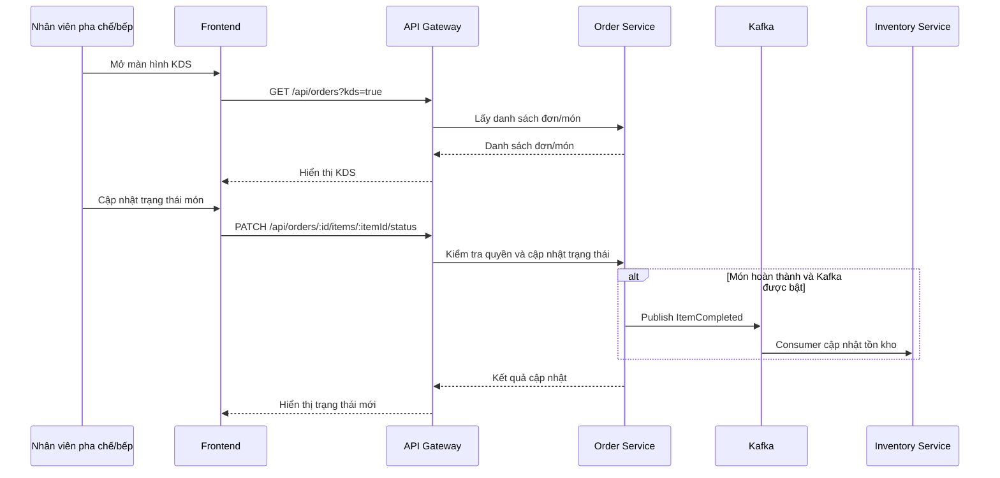

#### 4.1.2.3. Sequence xác nhận thanh toán tiền mặt

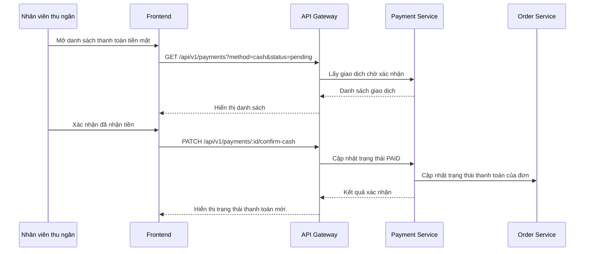

### 4.1.3. Nhóm chức năng Quản lý/Admin

#### 4.1.3.1. Sequence quản lý menu

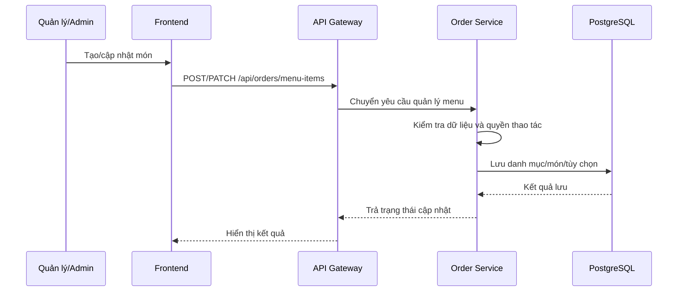

#### 4.1.3.2. Sequence quản lý kho và cảnh báo tồn thấp

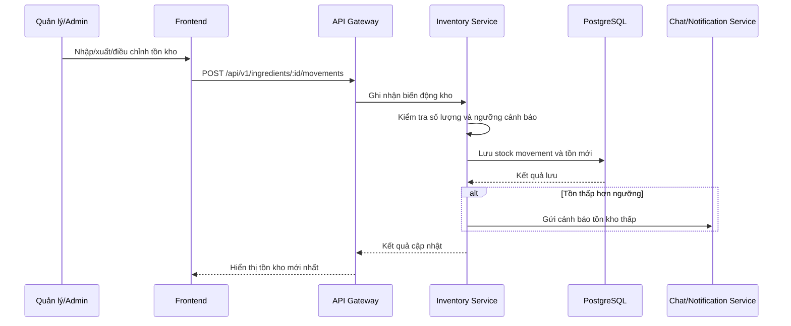

#### 4.1.3.3. Sequence quản lý nhân viên/ca làm

```mermaid
sequenceDiagram
    participant Admin as Quản lý/Admin
    participant FE as Frontend
    participant GW as API Gateway
    participant User as User Service
    participant DB as PostgreSQL

    Admin->>FE: Tạo/cập nhật nhân viên hoặc ca làm
    FE->>GW: POST/PATCH /api/users/staff
    GW->>User: Chuyển yêu cầu nhân sự
    User->>User: Kiểm tra quyền, vai trò và dữ liệu
    User->>DB: Lưu nhân viên/chi nhánh/ca làm
    DB-->>User: Kết quả lưu
    User-->>GW: Trả kết quả cập nhật
    GW-->>FE: Hiển thị dữ liệu mới nhất
```

#### 4.1.3.4. Sequence xem báo cáo/dashboard

```mermaid
sequenceDiagram
    participant Admin as Quản lý/Admin
    participant FE as Frontend
    participant GW as API Gateway
    participant Report as Report Service
    participant DB as PostgreSQL

    Admin->>FE: Mở dashboard báo cáo
    FE->>GW: GET /api/reports?from=...&to=...
    GW->>Report: Chuyển tiếp yêu cầu báo cáo
    Report->>DB: Tổng hợp dữ liệu đơn hàng/kho/thanh toán/nhân sự
    DB-->>Report: Dữ liệu báo cáo
    Report->>Report: Tính chỉ số và nhóm dữ liệu
    Report-->>GW: Kết quả tổng hợp
    GW-->>FE: Trả dữ liệu dashboard
    FE-->>Admin: Hiển thị báo cáo
```
